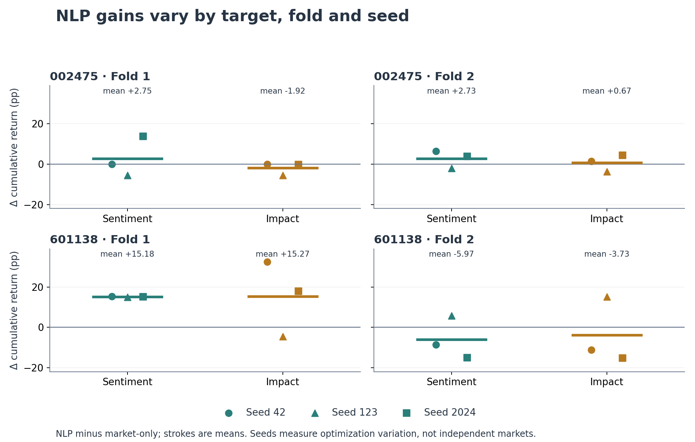
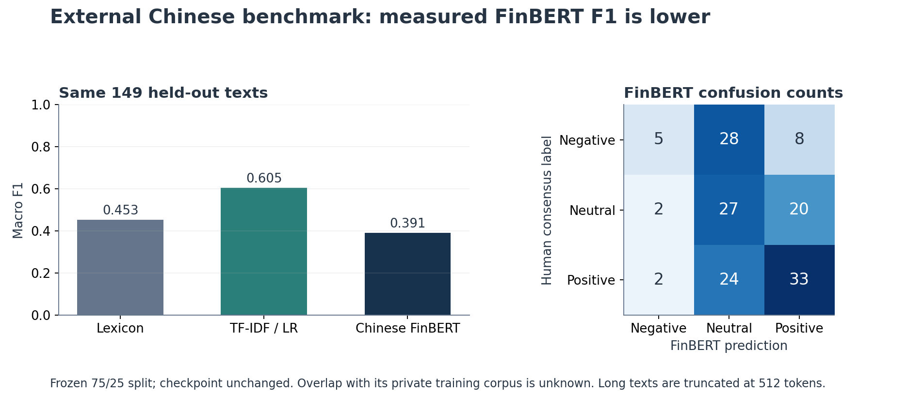

# NLP-Driven Reinforcement Learning Trading Platform

### From Financial News to Trading Decisions

A group project for **Data Analysis and FinTech Fundamentals**.

[Overview](#project-at-a-glance) · [Journey](#project-journey) · [Experiments](#experiments-and-evidence) · [Demo](#explore-the-dashboard) · [Report](reports/refinement_report.md) · [中文](README.zh-CN.md)

This project investigates whether financial news provides incremental information for DQN-based stock trading. We connect market and news data, peer-trained text signals, a custom trading environment and a Streamlit dashboard. The development process examines two practical challenges: uneven historical news coverage and hold-heavy trading behavior. The repository presents the system, its design iterations, experimental comparisons and the limits of the available evidence.

**Evidence status:** real-data Full runs are complete for 002475 and 601138: 36 DQN agents, 200 episodes each, two folds and three seeds. NLP differences vary by stock, fold and seed; 11 agents execute no test trades. Chinese FinBERT inference is complete on external human labels: common-test macro F1 is 0.391, versus 0.605 for TF-IDF/LR. Historical disclosure timing is inferred conservatively and checkpoint training overlap is unknown. See the [real experiments](docs/real_experiments.md) and [FinBERT evaluation](docs/finbert_evaluation.md). Preserved May 2026 diagnostics are excluded from these results.

## Project at a glance

| What we built | What you can inspect |
|---|---|
| Financial data pipeline | existing scraper, cache, source statement and [input/coverage contract](docs/data.md) |
| Peer-trained NLP signals | sentiment and return-labelled impact paths with [availability and maturity boundaries](docs/methodology.md) |
| Handwritten DQN experiment | replay buffer, target network, chronological trading ledger and [fixed comparison runner](scripts/run_coursework.py) |
| Interactive analysis | project overview, news-to-decision trace, paired results and methods in [Streamlit](src/dashboard/streamlit_app.py) |

The teaching baseline uses eight state slots and Buy/Hold/Sell. Existing normalized 12-dimensional states, target-position actions and DQN variants remain available as supplementary explorations. The fixed core comparison uses the eight-slot state with training-window scaling and three actions. Its configuration is fixed before viewing test returns.

## Research question

Can signals learned from non-target peer news improve the target stock's DQN decisions under the same market window, costs, architecture and training budget? Target exclusion and chronological isolation are separate requirements. A corpus can exclude the target and still contain future peer information; the new runner therefore fits upstream models before the RL training window.

## How it works


[Editable diagram source](docs/diagrams/system-overview.mmd)

Market features and each agent's account state are common inputs. Sentiment and impact are parallel alternative signals. Peer future returns supply matured training labels only. The control receives no text content. SQLite is a storage layer; the new result package stores full traces as files, while the existing SQLite integration persists core data through the legacy batch workflow.

## Project journey


[Editable diagram source](docs/diagrams/project-journey.mmd)

These are conceptual stages reconstructed from existing materials, not a dated schedule. In [the project journey](docs/project_journey.md), two cases connect observations to design responses: sparse historical news motivated peer-corpus organization; hold-heavy policies motivated state scaling, action exploration and behavior diagnostics. Neither response by itself demonstrates better economic performance.

## Experiments and evidence


[Editable diagram source](docs/diagrams/experiment-design.mmd)

Full uses an NLP training prefix, RL training and two non-overlapping test folds, with 200 episodes and three fixed DQN seeds. Every fold fits and trains again. The runner records input/code hashes, model configuration, cutoffs, label maturity, training rewards, scalers, test decisions and monetary costs. Buy-and-Hold uses the same execution and valuation conventions, once per fold.

All strategy risk measures include initial cash. Zero-volatility Sharpe is N/A. NLP effects are paired differences within stock, fold and seed. Seed variation describes optimization randomness and does not supply independent market observations. Expanded action/reward configurations belong in separate controlled comparisons.

| Evidence | Current interpretation |
|---|---|
| Original model-upgrade CSVs | historical diagnostics; require re-evaluation |
| New two-fold Smoke run | verifies fitting, training, ledger and trace paths on synthetic fixtures |
| Real-data Full comparisons | two targets, all 36 agents; variable paired effects, no stable-gain claim |
| External human-label NLP / FinBERT benchmark | shared 149-text test; pinned Chinese checkpoint; private training overlap unknown |

The [real-data report](docs/real_experiments.md) includes every configured fold and seed, negative returns and flat policies. The [FinBERT report](docs/finbert_evaluation.md) records the exact benchmark, model and limitations. The [first refinement addendum](reports/refinement_report.md) and [original course report](reports/final_report.md) remain historical context.





## Explore the dashboard

```bash
python -m streamlit run src/dashboard/streamlit_app.py
```


*Actual local reader with the completed 002475 Full result selected by default.*

Follow **Overview → News to Decision → Experiments → Methods & Project**. Choose an explicit result version, inspect when one story became available, see its model scores and actual DQN state/action, then compare the matching fold. This is traceability, not a causal explanation of a trade; Q-value differences are not profit probabilities.

The default reader opens the completed 002475 Full result. Select the 601138 Full version to inspect the other target. Opening it reads frozen local outputs without training or network collection. Smoke versions carry a synthetic-data warning. Advanced controls retain the original research workspace.

## Run it

From the repository root:

```bash
python3 -m venv .venv
source .venv/bin/activate
python -m pip install -r requirements-validation.txt
python -m pytest -q
python scripts/run_coursework.py --mode smoke
```

The repository includes frozen real source files, models, ledgers and benchmark predictions. Run `python scripts/validate_saved_evidence.py` to recompute the saved evidence. See [reproduction](docs/reproduction.md) for full retraining, pinned FinBERT download/inference and source recollection commands. The [legacy guide](docs/legacy_repository_guide.md) preserves earlier grid/CLI details for historical tracing.

## Team and deliverables

The five workstreams are data, NLP, storage, RL and the dashboard, with analysis and reporting across them. [Team contributions](docs/team.md) must be confirmed from team records; repository ownership is not a contribution assignment. Deliverables include the course specification, original report, presentation outline, live-demo script, implementation and reproducible notebooks.

## Limits and references

Disclosure titles are not complete media coverage. Date-only availability, retrospective qfq adjustments, weak labels, private checkpoint training overlap, previously viewed test periods and stochastic training limit interpretation. The daily ledger omits market microstructure and exchange trading restrictions. This is a course research platform, with no claim of live execution or stable profits. See [methodology](docs/methodology.md), [data provenance](docs/data.md), the [original course specification](docs/Project_Guidelines.docx), and the [Chinese FinBERT model card](https://huggingface.co/yiyanghkust/finbert-tone-chinese).
